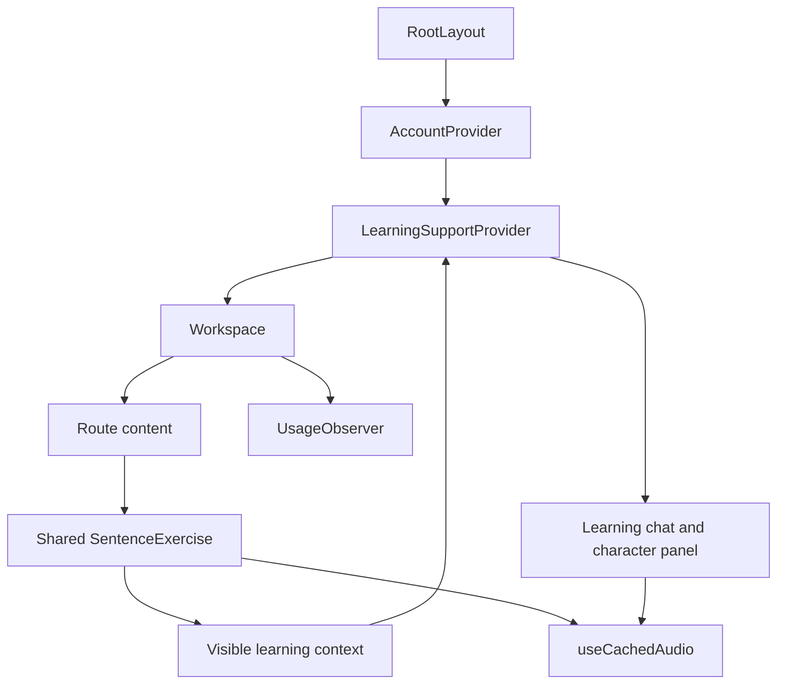

# Frontend composition

Inspected on 2026-11-07. The app uses the Next.js App Router, React contexts, and
shared client components. Exact versions and scripts live in
[package.json](../package.json). Read the installed Next documentation required
by [AGENTS.md](../AGENTS.md) before changing framework code.

## Provider tree

[RootLayout](../app/layout.tsx) mounts account and learning providers around the
[Workspace](../app/components/workspace.tsx). Account identity is shared across
pages. Learning support owns page context, conversation, and selected-character
state. Workspace owns navigation and mounts usage observation. Route components
compose feature components rather than establishing another application session.

## Route and component map

| Route | Main source | Behavior |
| --- | --- | --- |
| `/` | [app/page.tsx](../app/page.tsx) | Overview using saved progress |
| `/practice` | [SentenceExercise](../app/components/sentence-exercise.tsx) | Daily plan and failed-question queue |
| `/sentences` | [SentenceExercise](../app/components/sentence-exercise.tsx) | Reading and translation practice |
| `/listening` | [SentenceExercise](../app/components/sentence-exercise.tsx) | Shared workflow with listening settings |
| `/vocabulary` | [Vocabulary](../app/components/vocabulary.tsx) | Reviewed Anki expressions |
| `/progress` | [Progress](../app/components/progress.tsx) | Saved activity and assessment aggregates |
| `/connections` | [Connections](../app/components/connections.tsx) | Account and read-only Anki status |
| `/usage` | [UsageReport](../app/components/usage-report.tsx) | Administrator analytics and JSON export |
| `/reviews` | [Reviews route](../app/reviews/page.tsx) | Labelled demo |
| `/login` | [Login route](../app/login/page.tsx) | Neuron sign-in bridge |

## Network and identity boundary

Browser requests use the same-origin `/chapbackend-api` prefix. Production Nginx
routes it to Neuron. The optional `CHAP_BACKEND_ORIGIN` development rewrite is
validated in [next.config.ts](../next.config.ts). `CHAP_AUTH_ORIGIN` configures the
server-side Neuron origin and `CHAP_PUBLIC_ORIGIN` configures the browser origin
for login/logout. These are server configuration and must not contain credentials.

[Login](../app/api/auth/login/route.ts) and
[logout](../app/api/auth/logout/route.ts) route handlers perform the server-side
auth exchange and forward or clear the HttpOnly session cookie. Browser code
does not store passwords or provider API keys. [AccountProvider](../app/components/account.tsx)
reads the current account and handles explicit refresh. Successful authentication
does not create a learner or start paid generation. Backend permissions remain
authoritative, including the independent administrator permission for usage.

## Shared browser services

| Source | Responsibility |
| --- | --- |
| [learning-support.tsx](../app/components/learning-support.tsx) | Visible page/reveal context, companion, character details |
| [learning-api.ts](../app/lib/learning-api.ts) | Learning request contracts |
| [character-cache.ts](../app/lib/character-cache.ts) | Bounded general-definition cache, separate from phrase context |
| [use-cached-audio.ts](../app/components/use-cached-audio.ts) | Authenticated audio loading, playback, timing, stale-work cancellation |
| [audio-timing.ts](../app/lib/audio-timing.ts) | Provider timing validation and character synchronization |
| [audio-warmup.ts](../app/lib/audio-warmup.ts) | Local silent lead-in while preserving original speech |
| [exercise-layout.tsx](../app/components/exercise-layout.tsx) | Shared five-layout preference |
| [usage-observer.tsx](../app/components/usage-observer.tsx) and [usage.ts](../app/lib/usage.ts) | Signed-in page, vital, error-count, and fixed interaction measurements |

Account-scoped views must discard stale data when identity changes. Usage stores
a random tab session identifier and fixed fields. Keep question text, answers,
search terms, chat, credentials, and URL query values out of analytics. The report
must clear displayed data when access is lost. See backend `docs/USAGE-ANALYTICS.md`
for retention and server-side aggregation.
