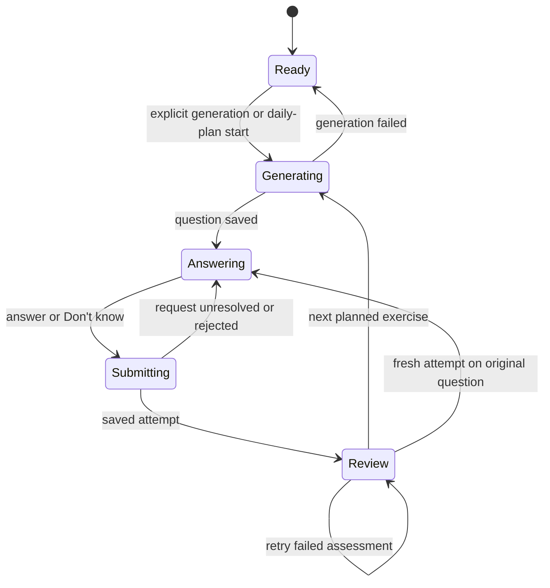

# Exercise state and shared behavior

Inspected on 2026-11-07. [SentenceExercise](../app/components/sentence-exercise.tsx)
owns reading, daily, and listening workflows. Read the
[product requirements](../FRONTEND-REQUIREMENTS.md) before changing these states.

## Attempt lifecycle

This diagram summarizes visible states. Read the component for request guards
and error handling. Generation, submission, and retry identifiers are retained
across uncertain network failures so retrying cannot create duplicate durable
work. Do not generate a new ID merely because the first response was lost.
Definitively rejected requests can clear their pending identity as implemented.

An `exercise` or `attempt` URL parameter restores saved server state. Unsubmitted
text is not autosaved. A historical review and a fresh attempt on its question
are different actions. Starting a fresh attempt resets the draft and reference
visibility. Provider failures show an ungraded state rather than a fabricated
incorrect result. Explicit "Don't know" submits empty text with its dedicated
flag and receives a zero score without an assessment provider call.

## Daily sequence

Creating a plan calls `/daily-plan/session` and automatically requests the first
slot. Pass that slot explicitly into generation instead of relying on a just-set
React state value. Plans mix translation directions, listening, and applicable
pattern reviews. A saved answer advances the plan index once. Its review stays
visible until the learner chooses Next. Completion and ending the session have
explicit states.

Next-question prefetch is keyed to learner, mode, difficulty, listening settings,
and current plan position/slot. Settings changes invalidate obsolete work. A
prefetched question stays hidden until selected. Preserve this distinction when
adding effects so background generation does not replace the active question,
discard a draft, or advance the plan twice.

## Reveal and contextual help

The server determines allowed question/review content. Before reveal, listening
must hide its transcript, pinyin, meaning, and matching companion context.
Reverse translation must keep its reference hidden. After reveal, Chinese text
supports character exploration. Visible context is published to
[LearningSupportProvider](../app/components/learning-support.tsx), with recent
actions bounded to the current learning activity. Do not send a hidden reference
to the companion merely because the browser has some question metadata.

General character meanings and pinyin can use the bounded character cache.
Phrase-specific explanations require their own context. Browser cache hits do
not replace backend ownership, membership, or reveal checks. Reset conversation
and character activity appropriately when moving to another exercise.

## Audio and layout

[useCachedAudio](../app/components/use-cached-audio.ts) owns playback and cancels
stale asynchronous loads/decoding. Original provider timestamps index Unicode
characters. Local warm-up adds 600 ms of silence and subtracts it from media time
for highlighting. Replay derives from the original bytes. Preserve timing through
speed changes, pause, seeking, replay, and cancellation. Silent warm-up is not
part of the provider cache.

[ExerciseLayout](../app/components/exercise-layout.tsx) offers Classic, Compact,
Focus, Split, and Immersive. The `chapp.exercise-layout` localStorage preference
uses `useSyncExternalStore`, same-page notification, cross-tab storage events,
and an in-memory fallback when storage is unavailable. Layout switching changes
presentation while preserving the active question, draft, review, and plan.
Use shared CSS variants rather than duplicating the workflow for a new look.

## Regression anchors

Use `practice-queue.browser.cjs` for queue/reload/fresh attempts,
`feedback.browser.cjs` for daily sequencing and layouts, and
`listening.browser.cjs` for audio-first reveal and controls. Character exploration
and caching have dedicated browser tests. Audio timing and warm-up each have
unit and browser regressions. See [development](DEVELOPMENT.md) for running them.
